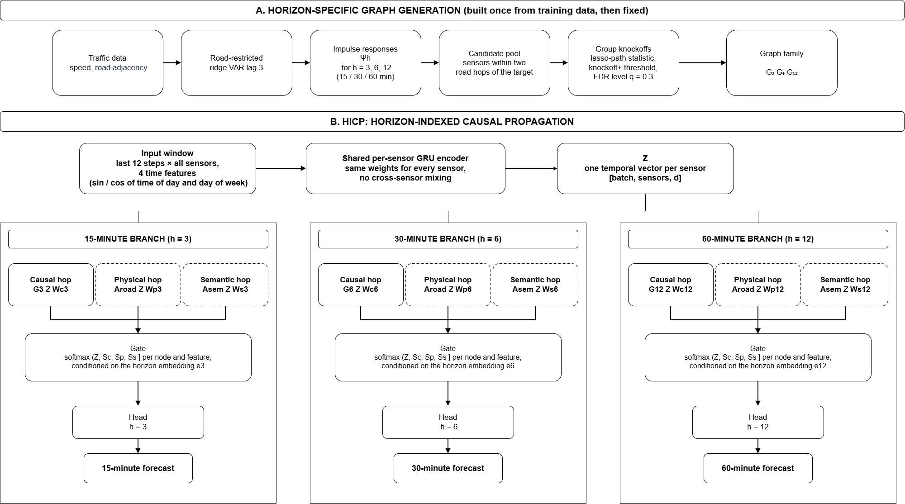

# HGP: Horizon-Specific Causal Graphs with False Discovery Rate Control for Multi-Horizon Traffic Forecasting

HGP builds a separate directed graph for every forecast horizon (15, 30 and 60 minutes) from the training data alone,
with the false discovery rate of the selected edges controlled, and forecasts each horizon through its own graph.
This repository contains the code of the proposed model.



## Method

**Part A: horizon-specific graph generation** (`hgp/graphs/`)

1. **Two-hop VAR.** A ridge vector autoregression (lag 3, penalty 10⁶) is fitted on the training rows. Each equation
   is restricted to the sensor itself and its candidate pool: the sensors within two road hops.
2. **Impulse responses.** Ψ_h gives the effect of every source on every target after *h* steps (*h* = 3, 6, 12).
3. **Group-knockoff selection.** For every target and horizon, group knockoffs test which pool sensors improve the
   *h*-step-ahead prediction beyond the target's own past. The knockoff+ threshold keeps the false discovery rate of
   the selected edges at *q* = 0.3, with at most 25 sources per target.
4. **Graph assembly.** Every selected edge is weighted by its standardised impulse response
   |Ψ_h[i, j]| σ_j / σ_i. Output: one weighted, directed graph G_h per horizon.

**Part B: the HICP forecaster** (`hgp/model.py`)

A GRU shared across sensors encodes each sensor's last 12 steps. For each horizon *h*, three branches each apply one
directed propagation step: over G_h (causal), over the road graph (physical) and over a learned similarity graph
(semantic). A softmax gate conditioned on a learned horizon embedding mixes the branches with the sensor's own
encoding, and a horizon-specific head produces the forecast. All three horizons come out of one forward pass.
The model has 327,483 parameters on PEMS-BAY.

## Repository layout

```
hgp/
  config.py            all settings of the proposed model (data split, Part A, model, training)
  data.py              loading, scaling with training statistics, input windows
  graphs/pool.py       two-hop candidate pool
  graphs/var.py        two-hop ridge VAR and impulse responses
  graphs/knockoffs.py  group knockoffs and the knockoff+ threshold
  graphs/build.py      graph assembly and storage
  model.py             HICP
  train.py             training, early stopping, test evaluation
  metrics.py           masked MAE (loss) and MAE / RMSE / MAPE
scripts/
  prepare_data.py      raw PEMS-BAY files -> data/pems_bay.npz
  build_graphs.py      Part A -> graphs/G_h3.npz, G_h6.npz, G_h12.npz
  train.py             Part B: train and test the proposed model
  summarise.py         test errors over seeds
tests/                 unit tests and an end-to-end run on synthetic data
docs/                  architecture diagram
```

## Installation

Python 3.10 or newer (tested with Python 3.12) and PyTorch 2.0 or newer.

```
pip install -r requirements.txt
```

Graph generation runs on the CPU. Training runs on the CPU for quick checks; the full training needs a GPU.

## Data

The experiments use PEMS-BAY: 325 speed sensors in the San Francisco Bay Area, January to June 2017, at 5-minute
resolution. Download `pems-bay.h5` and `adj_mx_bay.pkl` from the DCRNN repository
(<https://github.com/liyaguang/DCRNN>), then run

```
python scripts/prepare_data.py --traffic pems-bay.h5 --adjacency adj_mx_bay.pkl --out data/pems_bay.npz
```

The split is chronological, 70 / 10 / 20 % for training, validation and test. Zero readings are treated as missing
and are never used as targets; gaps of up to 30 minutes are interpolated in the model inputs only. Graphs and scaling
use training rows only, model selection uses the validation split, and the test split is scored once.

## Run

```
python scripts/build_graphs.py --data data/pems_bay.npz --out graphs                  # Part A, about 1 minute per horizon on a CPU
python scripts/train.py --data data/pems_bay.npz --graphs graphs --seed 42            # Part B
python scripts/summarise.py --results results                                         # test errors over the finished seeds
```

`build_graphs.py` writes, for each horizon, `graphs/G_h{h}.npz` (the graph; `adjacency[i, j]` is the weight of
source *j* for target *i*), `graphs/G_h{h}.json` (settings, edge count, build time) and `graphs/knockoff_h{h}.npz`
(the knockoff statistics of every target).

`train.py` writes `results/proposed__seed<seed>/` with `results.json` (test MAE, RMSE and MAPE per horizon and their
mean; mean gate weight of each branch per horizon), `history.csv` (per epoch), `checkpoints/best.pt` and
`test_predictions_h{3,6,12}.npz` (targets and predictions in mph with their timestamps).

Training protocol (fixed in `hgp/config.py`): AdamW, learning rate 3·10⁻⁴ with one warm-up epoch and cosine decay,
weight decay 10⁻⁴, gradient clipping at 5, batch size 16, at most 40 epochs with early stopping (patience 6) on the
validation MAE averaged over the three horizons. One run takes about 75 minutes on a single GPU.

The paper reports seeds 42, 7 and 123:

```
for s in 42 7 123; do python scripts/train.py --data data/pems_bay.npz --graphs graphs --seed $s; done
python scripts/summarise.py --results results
```

A seed fixes the initialisation and the data order. Runs on different GPU types, and graphs built with different
numpy / scikit-learn versions, can differ slightly: in our checks graphs built in two environments shared more than
99.5% of their edges.

Quick check of the whole pipeline on a CPU in a few minutes (40 sensors, 200 windows, 2 epochs):

```
python scripts/prepare_data.py --traffic pems-bay.h5 --adjacency adj_mx_bay.pkl --out data/quick.npz --subset 40
python scripts/build_graphs.py --data data/quick.npz --out graphs_quick
python scripts/train.py --data data/quick.npz --graphs graphs_quick --results results_quick --epochs 2 --max-windows 200 --device cpu
```

## Tests

```
python -m pytest tests -q
```

14 tests of the candidate pool, the two-hop VAR and its impulse responses, the knockoff statistics and threshold,
graph assembly, the model and its gate, windowing and metrics, PEMS-BAY preparation, and an end-to-end run (graphs,
training on two seeds, summary) on synthetic data. About 30 seconds on a CPU.

## Citation

If you use this code, please cite the accompanying paper (reference to be added on publication).
# HGP-Project
